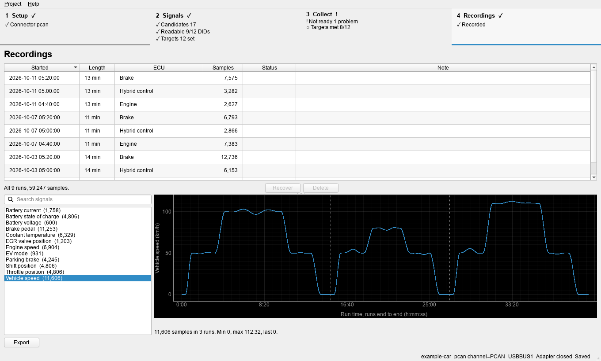

#  Toyota diagnostic telemetry tools

Find, verify, and record the diagnostic signals a vehicle reports over its
OBD-II CAN bus: which DIDs answer, which bits hold a value, and whether the
formula behind it holds up on the road. A command line and a desktop
application do the same work; four adapter workers talk to the vehicle.



*Example data; [more screenshots](docs/how-it-works.md).*

Everything it sends is read-only diagnostics (tester present, session control,
and reads by identifier or local identifier), checked against a built-in
allowlist before it reaches the bus. It never writes, codes, clears, or
unlocks anything.

> **Not affiliated with Toyota.** Toyota and Techstream are trademarks of their
> owners and are named only to describe what the tools work with. No Toyota
> software or data is included. Importing from Techstream requires your own
> licensed installation. Talking to a vehicle carries risk; use this at your
> own risk, never while driving, and never as an input to vehicle control or
> a safety warning.

## How it works

1. **Set up.** Create a private project workspace, choose your CAN adapter,
   and import a candidate signal list from your Techstream installation or a
   file you write.
2. **Verify.** Probe the candidate ECU addresses and read each DID once. Keep
   the ones that answer, and give each signal a target: what it still has to
   show, such as enough samples or each of its states.
3. **Collect.** Drive while the tool reads one ECU at a time, until every
   target is met.
4. **Review and export.** See which signals changed, stayed constant, or never
   answered, plot them, and export the signal list.

The toolkit holds no vehicle facts. For your vehicle you supply:

- a CAN adapter and its wiring to the OBD-II port;
- the bus speed and how an ECU opens a diagnostic session;
- the ECUs' request and response CAN IDs;
- candidate signals: DID, bit range, formula, unit, and state text.

[How it works](docs/how-it-works.md) explains each step, where each fact goes,
and how to find it.

## Install

You need 64-bit Windows, [uv](https://docs.astral.sh/uv/) (it fetches Python
if needed), Git, and a PEAK PCAN, J2534, candleLight/gs_usb, or slcan adapter.

```powershell
uv tool install "toyota-telemetry-tools[gui] @ git+https://github.com/4piu/toyota-telemetry-tools"
```

This puts `telemetry` (command line) and `telemetry-ui` (desktop application)
on the path. Installing compiles the adapter workers with the C# compiler
built into Windows; nothing else is needed. Omit `[gui]` for the command line
only. `uv tool upgrade toyota-telemetry-tools` updates to the latest commit.

## Help

- [How it works](docs/how-it-works.md): the four steps, what your vehicle
  needs and how to find it, safety, wiring, and decoding.
- [Diagnostic protocols](docs/protocols.md): how ECUs are reached and
  read, and which transports are supported.
- [Quickstart](docs/quickstart.md): every step as a command and as a desktop
  page, and where the built-in help is.
- [Adapters](backends/README.md) and [adding one](docs/adding-an-adapter.md).
- [Development](docs/development.md): layout, building, tests, packaging.
- Questions and bugs: [issues](https://github.com/4piu/toyota-telemetry-tools/issues).

## License

[MIT](LICENSE). The bundled `libusb-1.0.dll` is LGPL-2.1; see
[its notice](backends/Telemetry.Backend.Gsusb/runtime/README.md).
