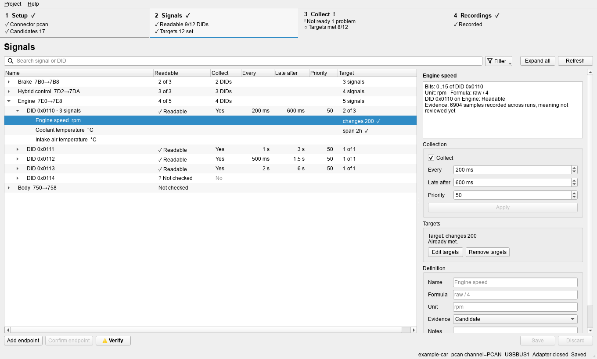
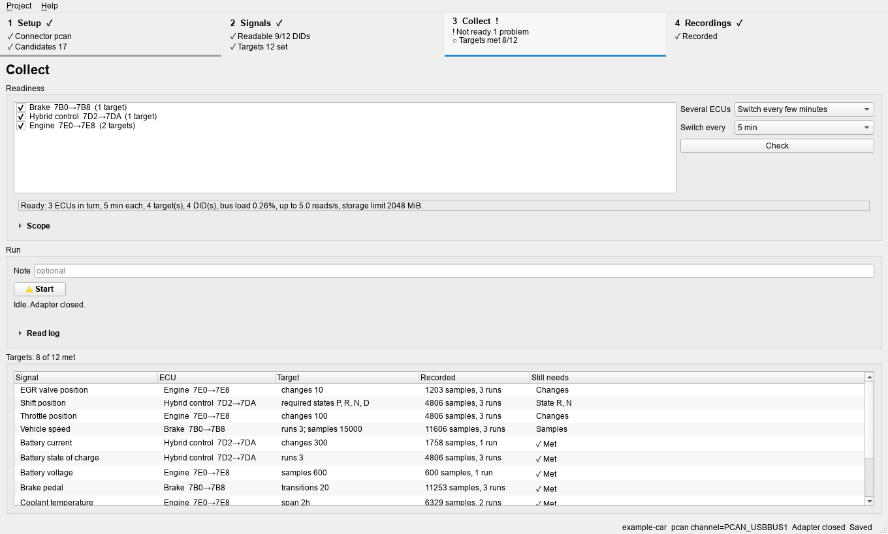
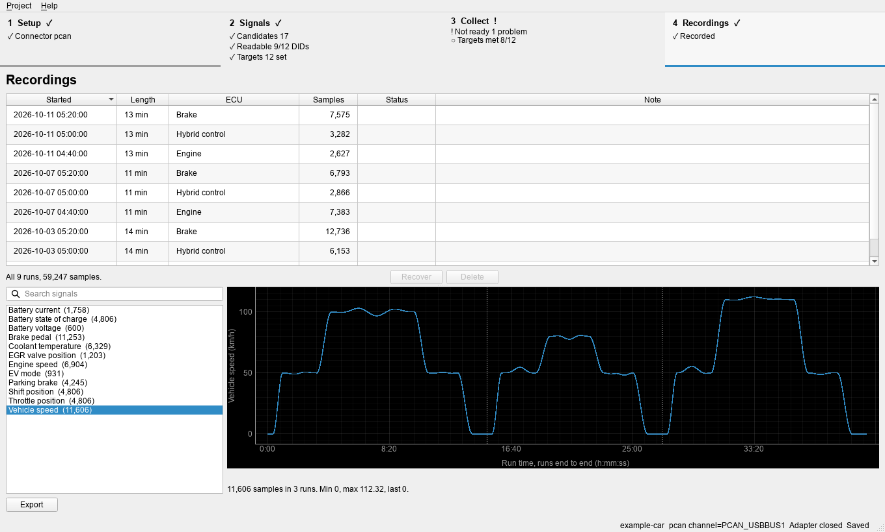

# How it works

The toolkit turns a list of *candidate* diagnostic signals (names, identifiers,
bit positions, and formulas that some source claims a vehicle supports) into a
list of signals you have seen working on your own vehicle. It does that in
four steps, which are also the four pages of the desktop application:

```text
 candidate list ─► 1 Set up ─► 2 Verify ─► 3 Collect ─► 4 Review and export
 (Techstream or    workspace,   probe ECUs,  drive while   which signals
  your own file)   adapter,     read each    targets are   changed, which
                   candidates   DID once,    being met     never moved;
                                set targets                signal list
```

Everything the tool sends is read-only diagnostics: tester present, session
control, and reads (`22 DID`, or `21 LL` on older ECUs). Commands and desktop actions for each step
are in the [quickstart](quickstart.md). Read [Safety](#safety) before
connecting anything. The screenshots below show an invented example project.

## What you need to find for your vehicle

The toolkit holds no vehicle facts. These are what you research, and where
each one ends up:

| You need | Example | Kept in | How to find it |
|---|---|---|---|
| A CAN adapter and its wiring | PCAN-USB on OBD-II pins 6 (CAN-H), 14 (CAN-L), 5 (ground) | Connector settings (this computer only) | The adapter's and vehicle's documentation; see [Wiring](#wiring) |
| Bus speed | 500 kbit/s, 11-bit identifiers | `config/transport.json`, `network` (500 kbit/s by default) | Service information; one answered OBD-II request proves it |
| How an ECU opens a diagnostic session | `3E 00`, then `10 03` | `config/transport.json`, a session recipe, written by hand | Watch what the OEM scan tool sends; see [Finding the session setup](#finding-the-session-setup) |
| ECU addresses | Request `0x7E0`, response `0x7E8`; or `0x750`/`0x758` with address `0x2A` behind a gateway | The candidate list, then confirmed endpoints | The OEM database's protocol records, or your own notes; Verify proves which ones answer |
| Signals | DID `0x1234`, bits 0..15, `raw / 1000`, V | The candidate list | The Techstream import, or a file you write |
| When each signal moves | Cruise on, reverse, parking brake | Collection targets | What the signal means; plan drives around it |

Most of a Toyota's signal facts come from Techstream's own databases, so with
a licensed installation the candidate list and the ECU addresses are one
import. The session recipe is the one fact you always supply yourself.

## 1. Set up

**Workspace.** A project is one private folder, created by the tool and kept
outside any repository. It holds the transport settings, the candidate list,
your review, recordings, and a local cache. Only the exported result leaves
it; back the folder up yourself.

**Connector.** Choose the adapter type (PCAN, J2534, gs_usb, or slcan) and its
channel or device. Checking the connector runs the worker self-test without
opening the device.

**Session recipe.** Add one recipe to `config/transport.json`. Only session
control (`10`) and tester present (`3E`) are accepted:

```json
"session_recipes": [{
  "id": "extended",
  "steps": [
    {"request_hex": "3E 00", "expected_prefix_hex": "7E 00",
     "label": "tester present", "tolerate_negative": true},
    {"request_hex": "10 03", "expected_prefix_hex": "50 03",
     "label": "extended session", "tolerate_negative": false}
  ]
}]
```

**Candidate list.** Import it from one or more sources. Importing previews
first, showing counts, conflicts, and rejected rows, then applies.

- *Techstream* (Windows): reads the installed databases through Techstream's
  own library. It takes each Data List item's name, DID, bit range, formula,
  unit, state text, and its ECU's CAN addresses. You need your own licensed
  installation; nothing from it is bundled here.
- *A file*: a JSON array of rows, for any other source:

  ```json
  [{"ecu_key": 1, "ecu_name": "Engine",
    "tester_can_id": "0x7E0", "response_can_id": "0x7E8",
    "data_id": "0x1234", "first_bit": 0, "last_bit": 15,
    "name": "Battery voltage", "formula": "raw / 1000", "unit": "V",
    "states": {}}]
  ```

  `ecu_key` is any number that groups one ECU's signals. For an ECU behind
  a gateway, add `"target_address": "0x2A"` (see
  [Gateways](#ecus-behind-a-gateway)). See [Decoding](#decoding) for bits,
  formulas, and states.

A database lists every variant it covers, so many candidates describe
equipment your vehicle does not have. That is expected; verification sorts
them out.

## 2. Verify

Verification is the first step that transmits. You select a finite set of
endpoints or DIDs from the candidate list (never a range or a sweep), review
the exact scope, and confirm it.

- An endpoint that has not answered yet is probed first: the session recipe,
  sent to its request address. With several recipes, each is tried in turn
  (the one most confirmed endpoints use first) until one opens a session, and
  that one is kept; `verify --recipe NAME` forces one. You then confirm each
  endpoint that responds, which adds it to the transport settings.
- Each selected DID is read once. Its answer, response size, and latency are
  recorded; collection needs them to plan safe request rates.
- A negative response is recorded too. It means the read was refused in that
  session and vehicle state, usually because this calibration does not
  support the DID even though the database lists it.

Then decide what to collect. Set how often each DID is read, and give each
signal a **target**: what it still has to show, for example enough samples
across several runs, each listed state, or a number of value changes. You can
correct a signal's name, formula, unit, or states here as well.



## 3. Collect

Collection reads one endpoint at a time over one held diagnostic session,
within the request rate and bus load limits in the transport settings. It
waits for each answer before the next request and never catches up with a
burst after a slow one. It skips signals whose targets are met and stops by
itself once every target is. With several endpoints it rotates, either in
time slices or one after another, and a run on each endpoint is recorded
separately.



Plan drives around the targets: a signal that only moves in reverse, with
cruise control on, or while the parking brake moves will not change on an
ordinary drive. Keep the computer on mains power with its lid open; the tool
keeps it awake.

## 4. Review and export

Each signal ends up in one of four states, based on every valid recording:

| State | Meaning |
|---|---|
| Changed | The value moved while recorded. The DID and bits are live on this vehicle. |
| Constant | The ECU answered, but the value never moved. Its condition never happened, the signal is unused, or it is a stored snapshot. |
| Beyond response | The bit range lies past the end of the ECU's answer: this vehicle's calibration does not carry it. |
| Not recorded | Not read yet. |

"Changed" proves that the location is live. It does not prove the formula.
Compare decoded values against an independent reference (the instrument
cluster, a known physical value, or a related signal) at rest, in the middle
and high range, in reverse or negative where that applies, and across state
transitions. The Recordings page plots runs for that, and a sample export
gives CSV for other tools.



Exporting the result writes the signal list (JSON, CSV, and a readable
Markdown table per ECU) with each signal's state, plus the transport
settings, into a folder outside the workspace. Recorded values never leave
the workspace, because readings such as the odometer identify a vehicle.

## Safety

- Start stationary in Park with the parking brake applied; use IG-ON or
  READY only when a test needs it.
- Only one tester may own an ECU's diagnostic session. Close Techstream,
  PCAN-View, and any other client before verifying or collecting.
- Never operate the computer while driving: use a passenger or an unattended
  logger, and secure the adapter, cable, and computer away from the pedals,
  steering, and driver.
- Never provoke hazardous events to meet a target. ABS, stability control,
  collision avoidance, airbag, and similar signals are observed only when
  they happen naturally.
- Do not keep sleeping ECUs awake or run the 12 V battery down.
- Disconnect after repeated busy or response-pending replies, transport or
  CAN controller errors, unexplained warning lamps, or ECU resets.
- Never use decoded values as an input to vehicle control or a safety
  warning.

## Wiring

On a standard OBD-II connector the high-speed CAN bus is usually pin 6
(CAN-H) and pin 14 (CAN-L), with ground on pin 4 or 5. Check the vehicle's
documentation and never guess from wire colour.

- Leave the adapter's 120 Ω terminator off: the vehicle bus is already
  terminated. With the vehicle off, CAN-H to CAN-L usually measures about
  60 Ω; investigate before transmitting if it reads open or much lower.
- A blinking adapter LED proves only local activity. Swapped CAN-L and ground
  can blink convincingly and receive nothing; check the conductors.
- Many diagnostic ports sit behind a gateway, so listening alone may show no
  traffic. One standard OBD-II request, such as `01 00` to `0x7DF`, proves
  the bus speed and wiring.

## Finding the session setup

The session recipe is the one thing no database import supplies, and there is
no automated way to derive it. What works is to record a real tester
conversation:

1. Connect Techstream through a J2534 interface and open a Data List with a
   single item of the ECU you want.
2. Save Techstream's J2534 log while values are updating
   (`tools/j2534/save-techstream-log.ps1`).
3. Turn the log into the ordered conversation
   (`tools/j2534/parse-j2534-log.py`) and read the requests sent before the
   first `22 DID` read: typically tester present, then a default session, then
   an extended session.

Without that, a bounded verification of a common pattern (tester present,
then `10 03`) is a reasonable experiment, and some ECUs answer `22` reads with
nothing more than tester present. Treat either as a guess until an ECU accepts
it.

The tester-to-response pairing is often request + 8 (`0x7E0` → `0x7E8`), but
not always; the import marks database pairings as candidates, and only an
answer confirms one. `tools/techstream/inspect-session.py` lists which ECUs a
saved Techstream session (`.TSE`) used, without exposing its contents; keep
the session file private, as later sections can hold the VIN.

## Decoding

- **Bits.** Bit 0 is the most significant bit of the first data byte after
  the `62 DID` echo (`61 LL` for a local identifier), and the bits from first to last form an unsigned
  big-endian raw value. Techstream's database numbers bits the same way.
- **Formulas.** A formula uses `raw`, numbers, `+ - * / **`, and
  `signed(raw, WIDTH)`. Techstream's numeric records have the form
  `((raw * A / B) + C) / (10 ** N)`. A negative display range does not make
  the field signed: an unsigned value plus a negative offset is common.
- **States.** `states` maps raw values to text, for example
  `{"0": "OFF", "1": "ON"}`. Techstream's state text includes inverted
  switches (0 = ON) and labelled special values such as 0 = "None". A raw
  value missing from the set is unknown, and the text is the database's
  claim until behaviour agrees with it.
- **Invalid values.** Fixed patterns such as all ones (`0xFFFF`) often mean
  "not available"; a value that never leaves one is a sign the signal is
  unused on this vehicle.

## ECUs behind a gateway

Many body, chassis, and driver-assistance ECUs are not on the diagnostic bus
directly. A gateway forwards to them through one shared request ID (on
Toyotas usually `0x750`, answered on `0x758`), and the first byte of every
frame, in both directions, is the address of the ECU meant: ISO 15765-2
extended addressing. Each frame then carries one data byte less.

The toolkit treats each address as its own endpoint: `750-758-2a` is the
ECU at address `0x2A`. The Techstream import reads the address from the
database, a candidate file gives it as `target_address`, and `endpoint add
... --address 0x2A` (or Address in the desktop Add endpoint dialog) adds one
by hand. Verification and collection then send and accept only frames
carrying that address; frames from the other ECUs on the same response ID
are ignored.

## Older ECUs: local identifiers

Some ECUs, often body modules behind the gateway, predate `22 DID`. They
refuse tester present with `7F 3E 12`, answer `22` with `7F 22 11`, and are
read with `21 LL`: one byte, a *local identifier*, answered by `61 LL` and
its data. Techstream describes them in its phase-4 databases; the import
reads those along with the current ones (it tells them apart by the data
list each database holds, not by file name) and stores local identifier
`LL` as DID `0x00LL`.
That range is reserved for DIDs, so the toolkit treats any DID below
`0x0100` as a local identifier and reads it with `21 LL`. Items whose layout
the import does not understand are rejected rather than guessed. Such ECUs
may accept no session change; a session recipe with only tester present
(negative reply tolerated) opens them.

## Limits

- Classical CAN with 11-bit identifiers, with normal or extended addressing.
  CAN FD and 29-bit identifiers are rejected in configuration. A gateway's
  response ID is taken as request + 8 until an ECU answers on it.
- ECUs reached over K-line (older vehicles, OBD pin 7) or diagnostic
  Ethernet (DoIP, the newest driver-assistance ECUs) are not supported; the
  Techstream import leaves them out.
- Safety-critical signals that cannot be provoked safely stay untested unless
  they occur naturally; a constant value is never treated as proof that a
  signal is absent.
- Dynamic (composite) DIDs can be replayed when their exact definition is
  known (`dynamic_dids` in the transport settings), but the toolkit does not
  discover them.

[Progressive validation](progressive-validation.md) details targets and
collection.
